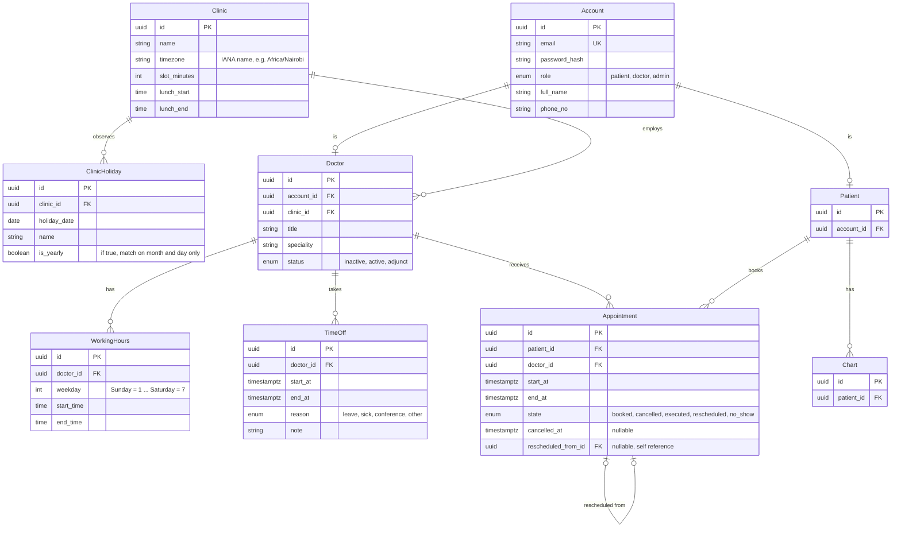

## Data model

### Entity relationship diagram



### Enums

**Doctor.status**

| Value      | Meaning                                  | Bookable? |
| ---------- | ---------------------------------------- | --------- |
| `active`   | Regular doctor                           | Yes       |
| `adjunct`  | Part-time or visiting doctor             | Yes       |
| `inactive` | Left the clinic or long-term unavailable | No        |

**Appointment.state**

| Value         | Meaning                                            | Holds the slot?        |
| ------------- | -------------------------------------------------- | ---------------------- |
| `booked`      | Confirmed, upcoming                                | **Yes**                |
| `cancelled`   | Cancelled, no replacement                          | No                     |
| `rescheduled` | Moved; a newer appointment points back to this one | No                     |
| `executed`    | The visit took place                               | No (it is in the past) |
| `no_show`     | The patient did not attend                         | No (it is in the past) |

`cancelled` and `rescheduled` are deliberately separate states. Both release the slot, but keeping them apart lets us answer questions such as "how many appointments did patients abandon versus move?" without guessing.

State transitions:

```
booked -> cancelled
booked -> rescheduled
booked -> executed
booked -> no_show
```

All other states are terminal.
